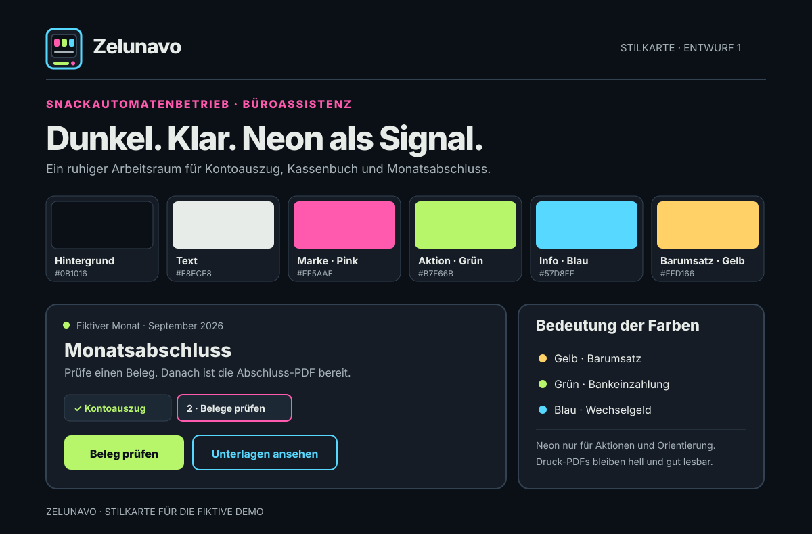

# Zelunavo – Büroassistenz (fiktive Demo)

Diese HTML-Demo zeigt einen möglichen monatlichen Ablauf für einen Snackautomatenbetrieb. Alle mitgelieferten Dateien und der Chat-Screenshot sind erfunden. Die Demo ist ein Studienprojekt und nicht für den Einsatz mit echten Geschäfts- oder Mitarbeiterdaten bestimmt.

**Projekt-Highlights:** [Timeline der Entwicklung](Timeline_Gesamtprojekt_Zelunavo.html)

## Projektziel

Das angestrebte Bewertungsziel ist **Level 1**. Die Vorführung zeigt einen nachvollziehbaren, nutzerkontrollierten Agentenworkflow: Arbeitsschritte werden sichtbar, Ergebnisse anhand fiktiver Prüffälle gemessen und unsichere Fälle zur Bestätigung vorgelegt. Diese Zielstufe ist die Projektentscheidung der Autorin; eine Bestätigung durch den Kursleiter wird damit nicht behauptet. Die Demo benötigt keine echten Konten oder Geschäftsdaten.

## Gestaltung und Stilkarte

Die Demo nutzt die eingefrorene Stilkarte 1.0 eines modernen Snackautomaten: dunkle Flächen, gut lesbare hellgraue Schrift und sparsame Akzente in Neonpink, Neongrün und Neonblau. Das neue Logo zeigt einen vereinfachten Automaten. `theme-dark.css` ist die maßgebliche Implementierung; neue Funktionen werden in dieses Design eingepasst.



[Ausführliche Stilkarte](STILKARTE.md) · [HTML-Vorschau](stilkarte.html) · [Logo als SVG](zelunavo-logo.svg)

Die Oberfläche ist auf die dunkle Farbwelt umgestellt. Neongrün markiert Hauptaktionen, Pink die Marke und aktive Navigation, Blau Links und Nebenaktionen. Im Kassenbuch bleiben Gelb für Barumsatz, Grün für Bankeinzahlungen und Blau für Wechselgeld. Die druckbaren PDFs bleiben hell und gut lesbar.

## Demo ausprobieren

Vollständige fiktive Monatsfälle sind für **Mai bis Oktober 2026** vorbereitet. Der Mai-Fehlerprüfungsfall liegt als `fiktive-testdaten/Zelunavo_Monatsfall_Mai_2026_FIKTIV_Fehlerpruefung.zip` vor und enthält sechs Rechnungen mit unterschiedlichen Fehlerarten. Der Oktober-Monatsfall liegt als `fiktive-testdaten/Zelunavo_Monatsfall_Oktober_2026_FIKTIV.zip` vor und wird in der Demoversion im Hintergrund geladen. Nach Auswahl des Oktober-Kontoauszugs stehen dessen Rechnungen, sechs Automatenberichte, Verkaufsbericht, MHD-Screenshot und Stundenzettel bereit. Elf ausdrücklich belegfreie Buchungen werden nach den Regeln dieses fiktiven Monatsfalls gekennzeichnet; die Amazon-Rechnung bleibt bewusst ein manueller Upload-Beleg. Die automatische Komplettprüfung enthält Juni bis September und prüft Kassenbuch, MHD-Liste, Abschluss-PDF und Browserablage:

### Monatspaket für neue Monate

Der Oktober-ZIP-Lader läuft im Hintergrund und fügt kein zusätzliches Steuerelement zur Oberfläche hinzu. Monatsdateien werden ausschließlich im Demomodus geladen. Der Kassenbestand beginnt mit dem Endbestand des Vormonats; Bargeldeinzahlungen kommen aus dem Kontoauszug und das Wechselgeld wird anhand des Monatsfalls ergänzt. Der Abschluss bleibt gesperrt, bis die Buchungsliste bestätigt ist und das Kassenbuch auf 0,00 € steht.

Im ZIP muss im obersten Ordner eine `manifest.json` liegen. Alle dort genannten PDFs müssen ebenfalls im ZIP enthalten sein:

```json
{
  "month": "2026-10",
  "statement": "Kontoauszug_Oktober_2026_FIKTIV.pdf",
  "salesReport": "Verkaufsbericht_Oktober_2026_FIKTIV.pdf",
  "invoices": ["Rechnungen/Rechnung_001_FIKTIV.pdf"],
  "automationReports": [
    {"machine": "Demoautomat Nord", "file": "Automatendaten/Nord.pdf"},
    {"machine": "Demoautomat Mitte", "file": "Automatendaten/Mitte.pdf"},
    {"machine": "Demoautomat Süd", "file": "Automatendaten/Sued.pdf"},
    {"machine": "Demoautomat Getränke", "file": "Automatendaten/Getraenke.pdf"},
    {"machine": "Demoautomat Snacks", "file": "Automatendaten/Snacks.pdf"},
    {"machine": "Demoautomat West", "file": "Automatendaten/West.pdf"}
  ],
  "mhd": {
    "recorded": "01.10.2026",
    "rows": [
      {"article": "Fiktiver Müsliriegel", "quantity": 12, "expiry": "20.10.2026"}
    ]
  }
}
```

Jeder Automatenbericht muss den im Manifest genannten Namen sowie eine Monatssumme mit Münzen, Scheinen und deren Summe enthalten. `salesReport` verweist auf eine separate Verkaufsbericht-PDF. Deren PDF-Metadaten müssen im Titel den Monat im Format `JJJJ-MM` und `FIKTIV` enthalten; der Betreff muss exakt den Zeitraum `TT.MM.JJJJ bis TT.MM.JJJJ` vom ersten bis letzten Kalendertag des Monats enthalten. Ein Paket muss damit sechs unterschiedliche Automatenberichte, eine Verkaufsbericht-PDF, mindestens eine Rechnung und eine gültige MHD-Zeile enthalten. Die Demo akzeptiert Monate fortlaufend ab Oktober 2026, damit der Anfangsbestand zum Vormonat passt.

Das **Kassenbuch** hat eine eigene Vollansicht mit Monatswechsel für Mai bis September 2026. Gelb zeigt den Barumsatz je Automat aus den fiktiven Automatenberichten: **Münzen Kasse + Scheine Kassette**. Kartenzahlungen zählen nicht dazu. Für jeden der sechs Automaten liegt pro Monat ein eigener PDF-Bericht im Ordner `fiktive-testdaten/automatendaten/`. Die Demo findet die sechs Berichte des gewählten Monats und liest die Monatssummen; bei unvollständigen oder widersprüchlichen Berichten übernimmt sie keine Werte. Grün zeigt Bargeldeinzahlungen aus dem fiktiven Kontoauszug. Blau ist das manuell bearbeitbare Wechselgeld zurück in die Automaten. Der Kassenbestand ist Anfangsbestand plus Barumsatz minus Bankeinzahlungen und Wechselgeld; der Folgemonat übernimmt den Endbestand. Die fiktiven Beispielwerte sind so abgestimmt, dass **jeder Monatsendbestand 0,00 €** beträgt. Bei manuellen Änderungen zeigt die App einen offenen Restbetrag an und gibt die Abschluss-PDF erst nach dem Ausgleich frei. Das Kassenbuch startet leer. Die Monatswerte bleiben im geöffneten Tab erhalten und werden beim Neuladen der Demo verworfen; die lokale Arbeitsversion nutzt weiterhin ihren geschützten dauerhaften Speicher. In der lokalen Zelunavo-App enthält die fiktive Jahresdatei `Kassenbuch 2026.xlsx` beim ersten Öffnen die vorbereiteten Monate Mai bis Oktober 2026. „Änderungen speichern“ trägt jeden weiteren bearbeiteten Monat fortlaufend ein. Über den Button „Kassenbuch“ bei Abschnitt 6 lässt sich die komplette Jahresdatei in Excel öffnen. Demo- und Arbeitsdaten landen in getrennten lokalen Unterordnern. Wird derselbe Monat erneut gespeichert, wird dessen vorhandenes Monatsblatt aktualisiert; doppelte Monatsblätter entstehen nicht. Die Referenzdatei `Zelunavo_Kassenbuch_Mai_bis_September_2026_FIKTIV.xlsx` und der Excel-Download enthalten fünf Monatsblätter mit Formeln, und das Blatt des bearbeiteten Monats wird beim Abschluss als PDF eingefügt.

1. Öffne die Seite über einen Webserver oder GitHub Pages und wähle einen Monat von Mai bis September 2026. Beim direkten Öffnen als lokale Datei können Browser einzelne Funktionen sperren. Für den echten lokalen KI-Modus siehe den nächsten Abschnitt.
2. Lade den auf der Seite verlinkten fiktiven September-Kontoauszug herunter und wähle ihn als PDF aus. Die Demo liest die Buchungen und schlägt passende fiktive Belege vor. Im lokalen KI-Modus erscheint zusätzlich **„Mit Qwen prüfen“**: Qwen vergleicht Buchungstexte, Beträge, Monate und Rechnungsinhalte. Prüfe die Begründungen und bestätige die Liste. Fehlende oder unsichere Belege können ignoriert oder manuell ergänzt werden.
3. Lade den auf der Seite verlinkten fiktiven Chat-Screenshot herunter und wähle ihn im MHD-Bereich aus. Im lokalen KI-Modus liest Qwen die sichtbaren MHD-Angaben aus einem fiktiven PNG- oder JPEG-Bild. Ohne lokalen KI-Modus wird nur der mitgelieferte Beispielscreenshot erkannt. Prüfe die angezeigten Zeilen; Artikel, Menge und MHD kannst du korrigieren und mit **„Korrekturen übernehmen“** neu in Excel und PDF speichern.
4. Trage im Bereich **„Eigenen Stundenzettel erstellen“** deine fiktiven Arbeitstage mit Beginn, Pause und Ende manuell ein. Die Demo berechnet die Dauer für jeden Tag. Bemerkungen sind optional. Klicke auf **„Fertig – zum Abschluss hinzufügen“**. Änderungen nach der Bestätigung müssen erneut mit „Fertig“ bestätigt werden.
5. Öffne **„Agentenlauf“** in der Menüleiste. Dort siehst du erkannte Buchungen, Belegzuordnungen, den Kassenbestand, den MHD-Abgleich gegen fiktive Sollwerte und nach der Erstellung die geprüfte Seitenzahl der Abschluss-PDF. Das Laufprotokoll enthält nur Arbeitsschritte und Zähler und wird nicht gespeichert.
6. Im Bereich **„Agentenlauf & Ergebnisprüfung“** zeigt die Demo den Bearbeitungsstand, Zuordnungsverteilung, offene/unsichere Buchungen, Messwerte und ein sitzungsgebundenes Laufprotokoll. **„Regelwerk mit Prüffällen testen“** führt 41 fiktive Zuordnungsfälle aus: Monatsverwechslungen, gleiche Beträge mit falschem Lieferanten, falsche Summen, fehlende Belege, Bargeldeinzahlungen und doppelte Zuordnungen. **„Vollständige Monatsfälle prüfen“** führt die vier festen Monats-PDFs von Juni bis September durch den echten Demoablauf und prüft auch die MHD-Validierung, den Kassenbestand, das erzeugte Abschluss-PDF und die Demoablage. Zusätzlich enthält es acht gezielte MHD-Fehlerfälle, einen unlesbaren Kontoauszug und einen nicht ausgeglichenen Kassenbestand. Die Ergebnisse werden mit Soll/Ist-Werten je Prüfschritt angezeigt. Der lokale Button **„Qwen lokal mit Prüffällen testen“** führt zusätzlich acht fest eingebaute, fiktive Fälle gegen das tatsächlich installierte Qwen-Modell aus. Dabei nutzt Qwen keine hochgeladene PDF und keine Nutzereingabe.
7. Klicke auf **„Abschluss-PDF erstellen“**. Die Demo lädt die separate fiktive Verkaufsbericht-PDF für den Monat, prüft den Berichtszeitraum und fügt deren PDF-Seiten in die Abschlussdatei ein. Der bestätigte eigene Stundenzettel wird direkt nach dem vorhandenen fiktiven Mitarbeiter-Stundenzettel eingefügt. Gleichzeitig legt die Demo alle Monatsdateien automatisch in einer fiktiven Demoablage im Browser ab. Über **„Gesamten Demoordner als ZIP herunterladen“** erhältst du die vollständige Ordnerstruktur als Kopie. Die Abschluss-PDF, der Verkaufsbericht und einzelne Excel-Dateien lassen sich separat herunterladen. „PDF öffnen und drucken“ öffnet die PDF im Browser; der Druck wird dort von der nutzenden Person gestartet.

Die Abschluss-PDF enthält ausschließlich das Kassenbuchblatt des bearbeiteten Monats. Die separat herunterladbare Kassenbuch-Exceldatei enthält dagegen alle fünf Demomonate.

Die Abschluss-PDF enthält in dieser Reihenfolge:

1. fiktives Kassenbuch des Monats als PDF,
2. fiktive MHD-Liste als PDF,
3. separate fiktive Verkaufsbericht-PDF als Vendon-Export-Simulation,
4. fiktiver Stundennachweis und, nach Klick auf „Fertig“, der manuell erstellte eigene Stundenzettel im gleichen Stil,
5. ausgewählter fiktiver Kontoauszug,
6. bestätigte Rechnungen in der Reihenfolge der Buchungen.

Der September-Kontoauszug enthält **zwölf Buchungen**: acht mit fiktiven Belegen und vier Bargeldeinzahlungen auf das Bankkonto. Der Anfangssaldo ist keine zusätzliche Buchung. Für Bargeldeinzahlungen ist kein Rechnungsbeleg erforderlich.

## Fiktive Demoablage

Nach dem Abschluss speichert die Demo das Monatsarchiv im Speicher dieses Browsers (IndexedDB). Die Ablage ist nach `Abschluss-PDF`, `Kassenbuch`, `MHD-Liste`, `Sales-Report`, `Automatenberichte`, `Stundenzettel`, `Kontoauszug` und `Rechnungen` sortiert. Der Sales-Report-Ordner enthält die separat geladene Verkaufsbericht-PDF; die sechs Automatenberichte liegen getrennt unter `Automatenberichte`. Zur MHD-Liste gehört der Beispielscreenshot. Die Kassenbuch-Exceldatei im Archiv enthält nur den bearbeiteten Monat und Formeln für Summen und Endbestand. Ein erneuter Abschluss desselben Monats ersetzt dessen Demoarchiv; andere Monate bleiben erhalten.

Diese Ablage ist **kein echter Ordner auf dem Mac mini** und wird nicht in den GitHub-Projektordner geschrieben. Sie bleibt nur in diesem Browserprofil erhalten. Wird der Browserspeicher gelöscht, geht sie verloren. Deshalb kann der gesamte fiktive Ordner bei Bedarf als ZIP heruntergeladen werden. Für die spätere Arbeitsversion ist dieselbe Struktur als echte lokale Ablage auf dem Mac mini vorgesehen; der Dateisystemzugriff muss dafür separat und geschützt eingerichtet werden.

## Lokalen KI-Modus mit Qwen starten

Auf dem Mac müssen **Ollama** und das Modell `qwen3.5:9b` installiert und Ollama gestartet sein. Für diesen Modus zusätzlich Python 3 verwenden. Im Demoordner `Zelunavo-KI-Demo.command` öffnen oder im Terminal `python3 zelunavo_local_ai.py` ausführen. Anschließend `http://127.0.0.1:8766/` im Browser öffnen. Das Fenster mit dem lokalen Server während der Vorführung geöffnet lassen.

Die Python-Datei stellt die Demo ausschließlich auf `127.0.0.1` bereit und reicht die KI-Aufgaben an Ollama auf demselben Mac weiter. Es werden keine API-Schlüssel benötigt. Die öffentliche GitHub-Pages-Ansicht ruft keinen lokalen KI-Dienst auf und bleibt als fiktiver Beispielmodus benutzbar. Falls Ollama fehlt, zeigt die lokale Seite dies an; der feste Beispielscreenshot bleibt nutzbar.

Qwen erhält für den Rechnungsabgleich nur Kandidaten mit passendem Betrag und zulässigem Monat. Das Programm prüft die zurückgegebenen Dateinamen und verhindert, dass dieselbe Rechnung mehreren Buchungen zugeordnet wird. Ein unsicheres Ergebnis blockiert die Bestätigung, bis es geprüft, ignoriert oder durch einen Beleg ergänzt wurde. Bei der MHD-Erkennung müssen Datum, Monat, Artikel und Mengen gültig sein. Die Modellantwort bleibt eine prüfpflichtige Empfehlung.

**Lokale Evaluation:** Im Bereich „Agentenlauf“ kann das installierte `qwen3.5:9b` acht synthetische Mehrmonatsfälle prüfen. Die Demo zeigt pro Fall Soll, Ist und bestanden/Abweichung; insbesondere werden Monatsverwechslungen, Textbezug, fehlende Belege und doppelte Zuordnungen gemessen. Der Test verwendet keine von dir ausgewählten Dateien. Frühere Evaluation: Regelwerk 9/9 und Qwen 8/8 am 11.11.2026. Die aktuelle Regelwerk-Suite enthält 41 Fälle. Ergebnisse beschreiben nur diese festen Prüfsätze und belegen keine allgemeine Fehlerfreiheit.

## Was simuliert wird

- Die Demo liest 24 mitgelieferte fiktive Automatenberichte aus dem lokalen Demoordner und lädt zusätzlich die fiktive Verkaufsbericht-PDF für den ausgewählten Monat. Sie prüft deren PDF-Metadaten auf den exakten Monatszeitraum und fügt die PDF als separate Quelldatei an; sie baut den Verkaufsbericht nicht aus Kassenbuchzahlen nach. Ein echter Automatendienst, Gmail und ChatGPT sind **nicht verbunden**. Qwen ist nur im optionalen lokalen KI-Modus für Belegprüfung und MHD-Bildauslese verbunden.
- `demo-sources.js` definiert austauschbare Adapter für Kontoauszüge, Rechnungen, Automatenberichte, den monatlichen Verkaufsbericht als PDF, Stundenzettel und die Monatsablage. Die öffentliche Demo bindet diese an lokale fiktive Dateien und den Browser-Speicher; diese Adapter sind Erweiterungspunkte, keine Verbindung zu echtem Gmail oder einem Automatendienst.
- Zugangsdaten zu einem echten Automatendienst werden für die Demo nicht benötigt und sind nicht im Demoordner enthalten. Eine spätere Arbeitsversion braucht dafür eine geschützte Verbindung; diese ist noch nicht eingerichtet.
- Die reine Browserdemo erkennt **nur die unveränderte mitgelieferte Bilddatei** anhand ihres digitalen Fingerabdrucks und zeigt dazu vorbereitete Beispieldaten. Der optionale lokale KI-Modus liest weitere fiktive Screenshots tatsächlich mit Qwen aus.
- Der spätere Agent soll die echten Automatenberichte aus dem dafür vorgesehenen Dienst abrufen sowie Rechnungen und Stundenzettel aus Gmail. Diese Verbindungen, der Zugriffsschutz und die Prüfung unklarer Ergebnisse sind noch zu entwickeln.
- Die spätere Verarbeitung echter WhatsApp-Screenshots mit ChatGPT ist von der Nutzerin vorgesehen. Diese öffentliche Demo sendet keine Screenshots an ChatGPT. Weitere sensible Unterlagen und Zugangsdaten sollen für die spätere Arbeitsversion geschützt auf dem Mac behandelt werden.
- Die PDF-Verarbeitung läuft in dieser Demo im Browser. PDF.js 6.5.438 und die zugehörige Lizenz liegen versionsgebunden im Ordner `vendor/pdfjs-6.5.438/`; der PDF-Parser wird nicht mehr von einem externen CDN geladen. Die mitgelieferten PDF- und Excel-Hilfsbibliotheken liegen lokal in diesem Ordner.

## Datenschutz und Veröffentlichung

Nur diesen Demoordner und ausdrücklich freigegebene fiktive Unterlagen verwenden. Keine echten Kontoauszüge, Rechnungen, Stundenzettel, Screenshots, Passwörter, Schlüssel oder lokalen Arbeitsordner veröffentlichen. Eine öffentliche GitHub-Pages-Seite ist im Internet sichtbar. Vor einer tatsächlichen Veröffentlichung Inhalt, Dateimetadaten und Git-Verlauf erneut prüfen.

Der private Gmail-IMAP-Agent liegt außerhalb dieses Demoordners und ist nicht Teil der öffentlichen GitHub-Demo. Seine Zugangsinformationen liegen im macOS-Schlüsselbund und seine abgerufenen PDF-Dateien unter `~/Library/Application Support/Zelunavo/Monatsunterlagen/`; sie werden nicht in diesen Ordner kopiert. Die GitHub-Demo enthält nur die hier mitgelieferten fiktiven Dateien. Die `.gitignore` in diesem Ordner schließt versehentlich hineinkopierte lokale Zugangsdaten und Monatsablagen zusätzlich aus.

## Technische Dateien

- `index.html` – Oberfläche und fiktiver Belegabgleich
- `demo_workflow.js` – Zusammensetzen der fiktiven Monatsunterlagen
- `timesheet-ui.js` – manuelle Zeiterfassung und PDF-Erstellung für den eigenen fiktiven Stundenzettel
- `demo-archive.js` – fiktive Ordnerstruktur, dauerhafte Browserablage und ZIP-Download
- `theme-dark.css`, `theme-nav.js` – dunkle Stilkarte in der Demo und Markierung des aktiven Bereichs
- `local-ai.js`, `zelunavo_local_ai.py`, `Zelunavo-KI-Demo.command` – optionaler lokaler KI-Modus für Rechnungsabgleich und MHD-Bildauslese
- `agent-run.js`, `demo-sources.js`, `month-package.js`, `agent-evaluation-cases.js` – sichtbarer Agentenlauf und Messwerte, austauschbare fiktive Datenquellen, Monats-ZIP-Import sowie Monats- und Fehlerfälle
- `stilkarte-vorschau.svg`, `STILKARTE.md`, `stilkarte.html`, `zelunavo-logo.svg` – visuelle Stilkarte, ausführliche Regeln, Vorschau und neues Logo
- `demo-data.js`, `demo-kassenbuch.js`, `demo-automatendaten.js`, `demo-sales-reports.js`, `fiktive-testdaten/` – ausschließlich fiktive Beispieldaten, einschließlich eingebetteter Verkaufsberichte für den direkten Start über `file://`
- `build_demo_sales_reports.cjs` – reproduzierbarer Generator der fiktiven Verkaufsbericht-PDFs; die vorbereiteten Fälle liegen im Ordner `fiktive-testdaten/verkaufsberichte/`
- `pdf-lib.min.js` (Inhalt identisch mit dem offiziellen pdf-lib 1.17.1-Bundle), `jszip.min.js` (3.10.1) – mitgelieferte Bibliotheken; Lizenztexte liegen daneben

Es wurde aus diesem Ordner heraus nichts automatisch veröffentlicht.
